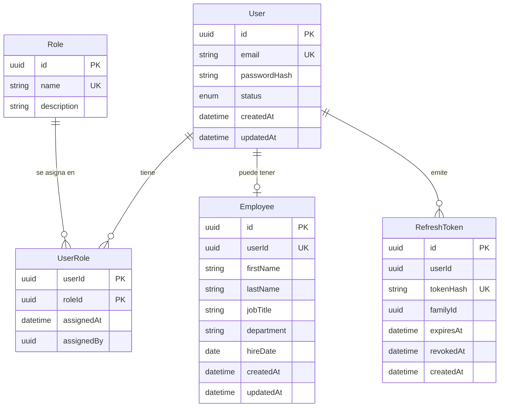

# Identity: modelo de datos

Documento 3 de la Fase 1. Define las entidades, atributos, relaciones e invariantes del servicio Identity. Es agnóstico de tecnología: los tipos son genéricos y la traducción a un ORM o base de datos concreta se hace en el documento de estructura del proyecto.

Estado: **borrador para revisión**.

## 1. Alcance

Identity es responsable de: credenciales, roles asignados, datos del personal interno y sesiones (tokens de refresco).

Identity **no** guarda datos propios de otros sistemas. En particular, los datos de cliente (nombre de envío, direcciones, etc.) viven en Store; Identity solo conoce el email y las credenciales de la cuenta. El teléfono de contacto del cliente (usado para notificaciones) también vive en Store.

## 2. Diagrama de entidades

## 3. Entidades

### User

Cuenta de acceso. Existe para todos los tipos de cuenta (clientes y personal).

| Atributo | Tipo | Notas |
|---|---|---|
| `id` | UUID v7 | Identificador público estable; es el `sub` del token y lo referencian los demás sistemas. |
| `email` | texto | Único, sin distinguir mayúsculas. Se usa para iniciar sesión. |
| `passwordHash` | texto | Solo el hash con un algoritmo moderno de contraseñas; nunca la contraseña. |
| `status` | enumeración | `active` o `disabled` (ver borrado lógico). |
| `createdAt`, `updatedAt` | fecha y hora | Auditoría básica. |

### Role

Catálogo fijo de roles definido en el documento de roles y permisos. Se carga con datos iniciales y no se modifica desde la API.

| Atributo | Tipo | Notas |
|---|---|---|
| `id` | UUID v7 | |
| `name` | texto | Único: `admin`, `employee`, `customer`, `inventory_manager`, `support_agent`, `store_manager`. |
| `description` | texto | Para qué sirve el rol. Se guarda en inglés, igual que el resto de los datos de la API. |

### UserRole

Relación muchos a muchos entre usuarios y roles (roles apilables). La clave es la pareja (`userId`, `roleId`), por lo que un usuario no puede tener el mismo rol dos veces.

| Atributo | Tipo | Notas |
|---|---|---|
| `userId` | UUID v7 | |
| `roleId` | UUID v7 | |
| `assignedAt` | fecha y hora | Cuándo se asignó. |
| `assignedBy` | UUID v7, opcional | Quién lo asignó. Vacío cuando lo asignan los datos iniciales o el propio sistema (por ejemplo, el registro de un cliente). |

### Employee

Datos del personal interno. Relación 1 a 1 con `User`.

| Atributo | Tipo | Notas |
|---|---|---|
| `id` | UUID v7 | |
| `userId` | UUID v7 | Único: un usuario tiene como máximo un registro de empleado. |
| `firstName`, `lastName` | texto | |
| `jobTitle` | texto | Puesto. |
| `department` | texto | Departamento. |
| `hireDate` | fecha | Fecha de ingreso. |
| `createdAt`, `updatedAt` | fecha y hora | |

### RefreshToken

Sesión renovable. Solo se guarda el **hash** del token, nunca el valor que recibe el cliente.

| Atributo | Tipo | Notas |
|---|---|---|
| `id` | UUID v7 | |
| `userId` | UUID v7 | Dueño del token. |
| `tokenHash` | texto | Único. |
| `familyId` | UUID v7 | Agrupa los tokens que descienden de un mismo inicio de sesión; permite revocar toda la cadena si se detecta reutilización. |
| `expiresAt` | fecha y hora | |
| `revokedAt` | fecha y hora, opcional | Se llena al usar el token (rotación), cerrar sesión o revocar. |
| `createdAt` | fecha y hora | |

> Los atributos de `RefreshToken` se confirman en el documento de flujo de autenticación, que define la rotación en detalle.

## 4. Reglas e invariantes

| # | Invariante | Criterio verificable |
|---|---|---|
| 1 | El email es único sin distinguir mayúsculas. | Registrar `A@x.com` cuando existe `a@x.com` responde `409`. |
| 2 | Nunca se guarda una contraseña ni un token de refresco en claro. | Ningún valor de `passwordHash` ni `tokenHash` coincide con el valor original en los tests. |
| 3 | Los usuarios no se borran físicamente: se pasan a `disabled`. | Eliminar un usuario deja el registro con `status = disabled`; el `id` sigue existiendo. |
| 4 | Un usuario `disabled` no puede iniciar sesión ni renovar tokens. | Login y refresh de un usuario `disabled` responden `401`. |
| 5 | Al desactivar un usuario se revocan todos sus tokens de refresco. | Tras desactivar, ninguno de sus `RefreshToken` queda sin `revokedAt`. |
| 6 | Un usuario con rol `employee` tiene exactamente un registro `Employee`; un `customer` no tiene ninguno; un `admin` no lo requiere. | Crear un `employee` sin datos de empleado responde `422`; crear `Employee` para un `customer` responde `409`; crear un `admin` sin `Employee` funciona. |
| 7 | Se cumplen las invariantes de combinación de roles del documento de roles y permisos. | Ver ese documento. |
| 8 | Todos los identificadores son UUID v7. | Los ids generados son versión 7. |

## 5. Borrado lógico

Los demás sistemas guardan el `id` del usuario en sus propios registros (movimientos, tickets, pedidos). Borrar físicamente al usuario dejaría referencias huérfanas y rompería la auditoría. Por eso un usuario se **desactiva** (`status = disabled`) y conserva su `id`.

Consecuencias:

- Se conserva el historial: quién hizo qué sigue siendo trazable.
- Un usuario desactivado no puede autenticarse.
- El email de un usuario desactivado sigue ocupado. Reutilizarlo requiere reactivar la cuenta.

## 6. Identificadores: UUID v7

Los identificadores son UUID versión 7. Frente a un entero autoincremental:

- No revelan cuántos usuarios existen ni se pueden adivinar.
- Se pueden generar sin consultar la base de datos.
- Al incluir una marca de tiempo al inicio, se ordenan cronológicamente y conservan buen rendimiento en los índices (a diferencia del UUID v4, que es aleatorio).

## 7. Decisiones y alternativas descartadas

| Decisión | Alternativa descartada | Motivo |
|---|---|---|
| `User` separado de `Employee` | Una sola tabla con campos de empleado opcionales | `User` sirve a todos los tipos de cuenta; los datos de empleado solo aplican a una parte. |
| Datos de cliente fuera de Identity | Guardarlos en `User` | Cada sistema es dueño de sus datos; Store necesita campos que Identity no debe conocer. |
| Borrado lógico | Borrado físico | Evita referencias huérfanas en otros sistemas y conserva la auditoría. |
| UUID v7 | Enteros autoincrementales / UUID v4 | No adivinable, generable en cualquier lugar y ordenable por tiempo. |
| Tabla explícita `UserRole` con `assignedAt` y `assignedBy` | Relación implícita sin atributos | Deja rastro de quién asignó cada rol. |
| Solo el hash de los refresh tokens | Guardar el token | Si la base se filtra, los tokens no son utilizables. |
| Teléfono del cliente en Store | Teléfono en `User` | Es un dato de contacto del cliente, no una credencial; Store lo incluye en los eventos que necesiten notificar. |
| `admin` sin registro `Employee` obligatorio | Exigir `Employee` a todo administrador | El admin es una cuenta de gestión, no necesariamente personal con puesto y departamento. |

## 8. Fuera de alcance (por ahora)

- Verificación de email y de teléfono.
- Autenticación de dos factores.
- Historial de cambios de roles más allá de `assignedAt` y `assignedBy`.
- Varios emails por usuario.
- Teléfono de contacto del personal interno.
- Reactivación y reglas de reutilización de email.
